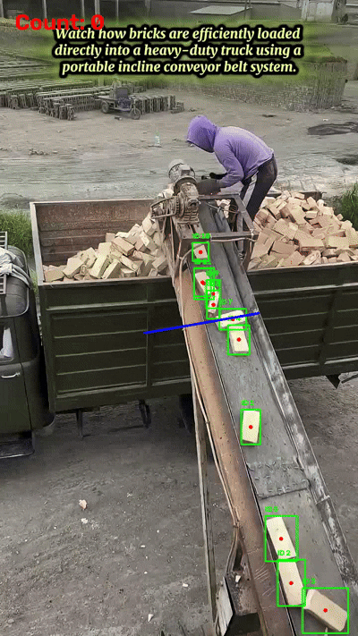
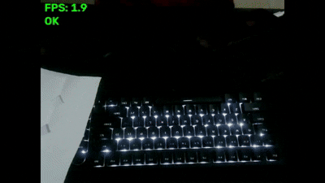

# ML Learning Journey

**Machine Learning, Deep Learning, Computer Vision, NLP & LLM Engineering Portfolio**


A public portfolio of hands-on ML and AI projects, built project by project from classical machine learning to deep learning, computer vision, NLP, and LLM systems.

I am a Chemical Engineer with one year of experience in a nickel smelter, now building ML and AI systems. That background shapes how I work: I care about root causes, honest evaluation, and problems that matter in industrial settings, such as defect inspection and process data.

---

## Highlights

- **29 projects** across five tracks: computer vision, large language models, NLP, deep learning, and applied machine learning.
- **1% improvement in every project:** each project ends with a written record of what I learned, so I get a little better every time.
- **Industrial computer vision:** defect segmentation with U-Net, automated product inspection, and product counting.
- **Modern detectors:** real-time object detection with YOLO, custom detection with Roboflow, and a YOLO vs RT-DETR comparison.
- **Private-document RAG:** a fully local retrieval pipeline with reranking that answers only from the document and says "I don't know" otherwise.
- **Applied NLP:** sentiment analysis, aspect-based sentiment analysis, topic discovery from social media, and resume information extraction.
- **Honest evaluation:** each project documents what worked, what did not, and why.

<p align="center">
  
  
</p>
<p align="center"><i>Left: real-time product counting with YOLOv8n. Right: real-time defect segmentation with a U-Net trained from scratch.</i></p>

---

## Portfolio at a Glance

| Track | Projects | Focus |
|---|---|---|
| [Computer Vision](computer-vision) | 7 | Object detection, segmentation, industrial inspection |
| [Large Language Models](large-language-models) | 2 | Local RAG, LLM-based assistant |
| [Natural Language Processing](natural-language-processing) | 4 | Sentiment analysis, topic discovery, information extraction |
| [Deep Learning](deep-learning) | 5 | CNNs, transfer learning, image classification |
| [Machine Learning](machine-learning) | 11 | Classification, prediction, forecasting, segmentation |

---

## Results Snapshot

Key results from selected projects. I report the limitation next to each result on purpose, because a number without its context can mislead.

| Project | Approach | Key result | Note |
|---|---|---|---|
| Industrial product counting | YOLOv8n vs RT-DETR | YOLOv8n: precision 0.988, recall 1.000, mAP50 0.995; counted all 17 products in the test video | 40-image dataset, single-camera setup |
| Industrial defect segmentation | U-Net from scratch (PyTorch) | Dice 0.708, IoU 0.548 | Measured on one validation image; 36-image dataset |
| YOLO vs RT-DETR comparison | Pretrained COCO weights | YOLOv8n showed higher confidence on shared objects | Qualitative only; confidence is not accuracy |
| Transfer learning benchmark | 10 architectures, identical settings | ResNet50 best, 100% test accuracy before and after fine-tuning | Only 19 test images |
| Traffic volume forecasting | Hist Gradient Boosting | MAE 257.16, R² 0.9496 (Linear Regression R² 0.1943) | Sequential split to prevent data leakage |
| CO sensor calibration | CatBoost | MAE 0.2913, R² 0.8923 | Gap to Random Forest is small (MAE 0.2933) |
| TikTok topic discovery | BERTopic | 24 topics plus an outlier group from 493 comments | Unsupervised; no ground-truth labels |
| RAG for private documents | BGE + FAISS + CrossEncoder + Llama 3.1 8B | Answered an in-document question; returned "I don't know" for an unrelated one | Two qualitative test cases |

---

## Computer Vision

Real-time detection and industrial inspection use cases.

| # | Project | What it does |
|---|---|---|
| 01 | [Object detection and annotation with YOLO](computer-vision) | Detects and annotates objects in images and video using YOLO |
| 02 | [Real-time object detection with YOLO](computer-vision/02-real-time-object-detection-using-yolo) | Real-time detection, extended into an automatic object-counting system |
| 03 | [Custom object detection with YOLO and Roboflow](computer-vision/03-real-time-custom-object-detection-using-yolo-and-roboflow) | Labels a custom dataset in Roboflow and evaluates with precision, recall, mAP50, and mAP50-95 |
| 04 | [YOLO vs RT-DETR comparison](computer-vision/04-YOLO-vs-RTDETR-preliminary-object-detection-comparison) | Qualitative, confidence-based comparison of pretrained YOLOv8n and RT-DETR on a live camera feed (no ground truth, so no mAP) |
| 05 | [Defect segmentation for product separation](computer-vision/05-defect-segmentation-for-automated-product-inspection) | Instance segmentation of product defects, evaluated with mAP |
| 06 | [Industrial defect segmentation with U-Net](computer-vision/06-industrial-defect-semantic-segmentation-with-u-net) | U-Net trained from scratch in PyTorch on 36 images, with real-time webcam inference. Evaluated with Dice score and IoU as a proof of concept |
| 07 | [Industrial product counting](computer-vision/07-industrial-product-counting) | Counts products on a conveyor with YOLOv8n and a counting line. YOLOv8n beat RT-DETR (mAP50 0.995 vs 0.898) while using about 11x less GPU memory (0.64 GB vs 7.14 GB) |

---

## Large Language Models

Fully local, privacy-first LLM applications that run offline with no external API.

| # | Project | What it does |
|---|---|---|
| 01 | [English learning assistant chatbot](large-language-models/01-english-learning-assistant-chatbot) | A local LLM tutor (Qwen2.5-0.5B), evaluated critically. It follows the system prompt well but makes factual grammar errors that temperature tuning did not fix. |
| 02 | [RAG for private documents](large-language-models/02-rag-for-private-documents) | Answers questions strictly from a confidential PDF using pypdf, LangChain text splitting (339 chunks), BGE embeddings, FAISS, CrossEncoder reranking, and Llama 3.1 8B via Ollama. Grounded answers for in-document questions, "I don't know" for out-of-scope ones, Evaluated with in-scope and out-of-scope test questions; formal Recall@k and faithfulness evaluation is planned. |

I also built a coding assistant agent, an English interview practice agent, and an end-to-end content production pipeline. These are private; demos are available on request.

---

## Natural Language Processing

Applied NLP on customer and text data.

| # | Project | What it does |
|---|---|---|
| 01 | [Classify sentiment of Google Maps reviews](natural-language-processing) | Collects reviews with Playwright, cleans the text, and classifies sentiment using TF-IDF features |
| 02 | [Aspect-based sentiment analysis for customer comments](natural-language-processing) | Extracts customer feedback into aspect categories and analyzes sentiment per aspect with transformer models |
| 03 | [Customer topic discovery from TikTok comments](natural-language-processing) | Discovers recurring topics in 493 TikTok comments with BERTopic: 24 topics plus an outlier group |
| 04 | [Resume information extraction with NER](natural-language-processing) | Extracts information from resumes using spaCy named entity recognition |

---

## Deep Learning

Image classification with CNNs and transfer learning.

| # | Project | What it does |
|---|---|---|
| 01 | [Fashion-MNIST classification](deep-learning/01-fashion-mnist-classification) | Image classification with the Keras Sequential API |
| 02 | [Face mask detection with CNN](deep-learning/02-face-mask-detection-using-convolutional-neural-networks) | CNN that detects face mask use |
| 03 | [Rotten apple classification with CNN](deep-learning/03-rotten-apple-classification-using-convolutional-neural-networks) | CNN that separates fresh from rotten apples |
| 04 | [Multi-class classification with ResNet50](deep-learning/04-multi-class-object-classification-using-resnet50-transfer-learning) | Transfer learning with ResNet50 |
| 05 | [Transfer learning architecture benchmark](deep-learning) | Benchmarks 10 transfer learning architectures under identical settings on a 164-image, 5-class dataset; ResNet50 performed best |

---

## Machine Learning

Tabular data problems from classification to forecasting.

| # | Project | Task |
|---|---|---|
| 01 | [Adult income](machine-learning/01-adult-income-classification) | Classification |
| 02 | [Wine quality](machine-learning/02-wine-quality-classification) | Classification |
| 03 | [Student dropout risk](machine-learning/03-student-dropout-risk-prediction) | Risk prediction |
| 04 | [Low-cost sensor calibration for CO prediction](machine-learning/04-air-quality-co-prediction) | Prediction |
| 05 | [Sales and engagement clustering analysis](machine-learning/05-customer-purchase-segmentation) | Clustering |
| 06 | [Retail customer segmentation](machine-learning/06-retail-customer-segmentation) | Clustering |
| 07 | [Customer churn](machine-learning/07-customer-churn-prediction) | Classification |
| 08 | [Traffic volume forecasting for logistics planning](machine-learning/08-traffic-volume-forecasting) | Time-series forecasting |
| 09 | [Household energy consumption](machine-learning/09-household-energy-consumption-prediction) | Prediction |
| 10 | [Preventive diabetes](machine-learning/10-preventive-diabetes-classification) | Classification |
| 11 | [Skin type suitability from cosmetic ingredients](machine-learning) | Multi-label classification |

---

## 1% Improvement in Every Project

I follow one simple rule: every project must leave me at least 1% better than before. Below is what I learned from each project.

<details>
<summary><b>Machine Learning (11 projects)</b></summary>

**01 · Adult Income Classification**
- Learned how cross-validation scores can help handle overfitting.
- Understood why `fit_transform` should be used only on the training data.
- Understood how feature importance works.

**02 · Wine Classification Prediction**
- Learned how to build a pipeline.
- Learned that SVC can give better results when a dataset has many features.

**03 · Student Dropout Risk Prediction**
- Understood how winsorizing works.
- Understood when to use an ordinal encoder and when to use a label encoder.

**04 · Low-Cost Sensor Calibration for CO Prediction Using Machine Learning**
- Learned that a robust scaler can help a base model handle outliers.
- Learned to use MAE rather than MSE for datasets with many outliers.
- Learned that CatBoost gives better results when a dataset has many outliers.

**05 · Sales & Engagement Clustering Analysis**
- Learned how to find the best k for clustering.
- Learned how to handle a sequential dataset.

**06 · Retail Customer Segmentation with Clustering**
- Learned how dimensionality reduction with PCA works.
- Learned about clustering models and their evaluation metrics.

**07 · Customer Churn Prediction**
- Learned hyperparameter tuning and applied it across multiple algorithms.
- Explored new algorithms such as Bernoulli Naive Bayes and Gaussian Process Classifier.

**08 · Traffic Volume Forecasting for Logistics Planning**
- Learned that temporal feature extraction from datetime can compensate for weak raw feature correlations, significantly improving model performance.
- Learned that using `train_test_split()` with the default `shuffle=True` is not always appropriate; in time series problems, sequential splitting is necessary to avoid data leakage.
- Tried feature extraction techniques when working with datasets that have low feature-target correlations.

**09 · Household Energy Consumption Prediction**
- Tried new models: Extra Trees, Lasso, and Elastic Net. Extra Trees gave good results on a dataset with low correlation, while Lasso and Elastic Net gave poor results.
- Learned that feature engineering can boost results.

**10 · Preventive Diabetes Classification**
- Understood which models are suitable or unsuitable for this case.
- Learned that using a robust scaler with a robust model can improve results.
- Applied Grid Search and Randomized Search for hyperparameter optimization.
- Gained a better understanding of how to balance predictive performance with computational efficiency.

**11 · Multi-Label Skin Type Suitability Classification from Cosmetic Ingredients**
- Learned how multi-label classification works.
- Understood how TF-IDF converts ingredient text into numerical feature vectors for machine learning models.
- Learned how `MultiOutputClassifier` enables classical machine learning algorithms to solve multi-label classification tasks.
- Learned about evaluation methods for multi-label output.

</details>

<details>
<summary><b>Deep Learning (5 projects)</b></summary>

**01 · Fashion MNIST Classification**
- Understood the basic deep learning flow: load data, normalize, build the model, compile, train, and evaluate. This flow has fewer steps than the classic ML pipeline, but each step requires more parameter decisions (layers, neurons, dropout, epochs).
- Learned how the Keras Sequential API works and how each layer connects to the next one.
- Realized that Dropout layers and a validation split are useful for preventing overfitting.
- Learned that normalization (scaling pixel values to 0-1) is a small step but has a big effect on how fast and stable the training process is.

**02 · Face Mask Detection Using Convolutional Neural Networks**
- Learned to use `pad_to_aspect_ratio` when handling datasets with highly varied image dimensions.
- Learned that data augmentation can help reduce class imbalance and improve model generalization.
- Learned that increasing the number of epochs does not always improve performance; identifying the optimal stopping point can save computational time while maintaining accuracy.

**03 · Rotten Apple Classification Using Convolutional Neural Networks**
- Learned that using a subset is unnecessary when the dataset is already separated into training, validation, and test folders.
- Compared different optimizers such as Nadam, Adam, and SGD, and found that Nadam provided the best performance on this dataset.
- Gained a better understanding of how the number of filters, kernel size, and pooling operations influence feature extraction in CNNs.

**04 · Multi-Class Object Classification Using ResNet50 Transfer Learning**
- Learned that prefetching lets the CPU and GPU run in parallel instead of waiting on each other, which improves training throughput.
- Learned that transfer learning can save significant training time while still producing strong results, without training a model from scratch.
- Learned the purpose of Global Average Pooling, Batch Normalization, and Dropout in a transfer-learning head.
- Learned the general transfer learning workflow: freezing the pre-trained backbone, then replacing and training a new "head" (classification layers) on the target dataset.

**05 · Benchmarking Transfer Learning Architectures on a Small Image Dataset**
- Learned how to benchmark multiple transfer learning architectures under identical experimental conditions.
- Understood that deeper architectures do not always outperform shallower ones on small datasets.
- Learned how architecture-specific `preprocess_input` functions affect transfer learning workflows.
- Gained practical experience with freezing pre-trained backbones and training only the classification head.
- Learned that fine-tuning should be validated experimentally because its impact varies across architectures.
- Understood the importance of interpreting high accuracy carefully when the evaluation dataset is very small.

</details>

<details>
<summary><b>Computer Vision (7 projects)</b></summary>

**01 · Object Detection & Annotation from Images and Video Using YOLO**
- Learned how YOLO works, and that a newer version is not always better for a given use case.
- Learned that confidence score and accuracy are not the same thing; measuring accuracy requires ground truth.
- Learned that threshold tuning is crucial and needs a sweet spot for every project.
- Learned that YOLO has a lot of potential to explore across many applications.
- Wrapped most of the process in reusable functions for cleaner, more maintainable code.

**02 · Real-Time Object Detection Using YOLO**
- Learned how YOLO can be applied to real-time object detection.
- Learned how object detection can be extended into an automatic object-counting system.
- Learned that object position and viewing angle can affect detection confidence.

**03 · Real-Time Custom Object Detection Using YOLO and Roboflow**
- Learned how to label and prepare a custom object detection dataset using Roboflow.
- Learned how dataset diversity, background, and camera angle can affect model performance.
- Learned to evaluate object detection models using precision, recall, mAP50, and mAP50-95 instead of relying only on confidence scores.
- Learned that strong evaluation results do not necessarily guarantee good real-world generalization when the dataset is small or too similar to the evaluation environment.
- Learned how a trained YOLO model can be integrated into a real-time computer vision application.

**04 · YOLO vs RT-DETR: Preliminary Object Detection Comparison**
- Learned how RT-DETR differs from YOLO in its object detection architecture and its end-to-end detection approach.
- Learned that detecting more objects does not necessarily mean better detection performance.
- Learned that model comparison requires consistent input conditions and appropriate evaluation metrics.
- Learned that no single object detection architecture is automatically the best for every use case.

**05 · Defect Segmentation for Product Separation**
- Learned how instance segmentation works.
- Learned to detect not only the "anomaly" but all parts of it.
- Learned how mAP metrics work.

**06 · Industrial Defect Semantic Segmentation with U-Net**
- Learned how to handle severe foreground-background class imbalance using `pos_weight` with `BCEWithLogitsLoss` and Dice Loss.
- Learned how BatchNorm can improve training stability in a U-Net trained from scratch.
- Learned how to convert polygon annotations into binary segmentation masks using `pycocotools`.
- Learned how Dice Score and IoU evaluate pixel-level segmentation performance.
- Learned the importance of evaluating models on unseen data rather than relying only on training loss.
- Learned that a small and controlled dataset can produce promising results while still having limited generalization to real-world conditions.

**07 · Industrial Product Counting**
- Learned that viewing angle and range are very important in computer vision.
- Learned that the practical limit for training RT-DETR on 8 GB of VRAM is a batch size of 16.
- Learned how to make a counting line.

</details>

<details>
<summary><b>Natural Language Processing (4 projects)</b></summary>

**01 · Classify Sentiment of Google Maps Reviews**
- Learned how to collect Google Maps reviews using Playwright.
- Learned how to clean noisy text using regular expressions.
- Learned how to use TF-IDF to identify important words and transform text into machine learning features.
- Learned how different architectures trade off computational efficiency and predictive performance.
- Learned that confidence in model performance should be supported by a sufficiently large and representative evaluation dataset.

**02 · Aspect-Based Sentiment Analysis for Customer Comments**
- Learned how to extract customer feedback into multiple aspect categories.
- Learned why text normalization, such as using `lower()`, is important for consistent text processing.
- Learned how transformer models can be applied to customer-generated text.
- Learned how aspect-based sentiment analysis can provide more actionable insights than overall sentiment classification.
- Learned that model confidence is not the same as model accuracy, and that proper evaluation requires ground-truth labels.

**03 · Customer Topic Discovery from TikTok Comments**
- Learned what `stop_words` does in a text vectorizer.
- Learned the basic mechanism of BERTopic.
- Learned how `ngram_range` affects topic representation.
- Learned how `min_df` helps filter low-frequency terms.
- Learned the difference between topic probability and prediction correctness.
- Learned how to interpret discovered topics using keywords and representative comments.

**04 · Resume Information Extraction with Named Entity Recognition (NER)**
- Learned how spaCy works.
- Learned how to extract information using NER.
- Learned how NLP can be applied to automate resume screening.
- Learned that off-the-shelf, small NER models need domain adaptation to perform well on specialized text like resumes.

</details>

<details>
<summary><b>Large Language Models (2 projects)</b></summary>

**01 · English Learning Assistant Chatbot**
- Learned how an LLM works, from tokenization, embedding, and self-attention/multi-head attention to detokenization.
- Understood the functions of `AutoTokenizer` and `AutoModelForCausalLM`.
- Understood why GPUs use float16 rather than the float32 used on CPUs.
- Learned about the `max_new_tokens`, `top_p`, and `temperature` parameters.

**02 · RAG for Private Documents**
- Learned how the parameters `k` and `top_n` work.
- Learned that `k=1` is not the same as the number of documents.
- Understood how `RecursiveCharacterTextSplitter` works.
- Understood the difference between SentenceTransformer for embedding and CrossEncoder for re-ranking, and that both come from the same library.
- Learned that retrieval requires transforming the query into a vector first.

</details>

---

## Tech Stack

| Area | Tools |
|---|---|
| Language | Python |
| Machine learning | Pandas, NumPy, Scikit-learn, CatBoost |
| Deep learning and vision | PyTorch, Keras / TensorFlow, CNNs, ResNet50, YOLO, RT-DETR, U-Net, Roboflow, pycocotools |
| NLP | spaCy (NER), BERTopic, TF-IDF, Hugging Face Transformers, Playwright (data collection) |
| LLM | SentenceTransformers, CrossEncoder, FAISS, LangChain, Ollama |
| Visualization | Matplotlib, Seaborn |

---

## Repository Structure

```
ml-learning-journey/
├── computer-vision/             # 7 projects
├── large-language-models/       # 2 projects
├── natural-language-processing/ # 4 projects
├── deep-learning/               # 5 projects
├── machine-learning/            # 11 projects
├── LICENSE
└── README.md
```

Each project lives in its own numbered folder with its notebook.

---

## How I Work

- Start from the problem, not the model.
- Compare against a baseline before adding complexity.
- Report failures and limitations, not only successes.
- Keep code reproducible and projects self-contained.
- Improve by at least 1% with every project.

---

## Contact

- **Email:** amrulloh.ml17@gmail.com
- **LinkedIn:** [linkedin.com/in/fauzan-amrulloh](https://linkedin.com/in/fauzan-amrulloh)

Open to junior ML / AI Engineer roles, especially computer vision, NLP, and applied ML for industrial and business problems.

## License

Released under the [MIT License](LICENSE).
