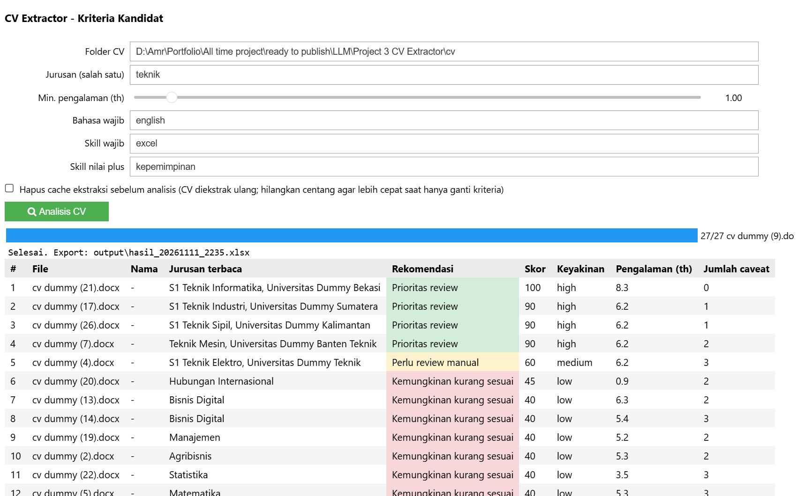
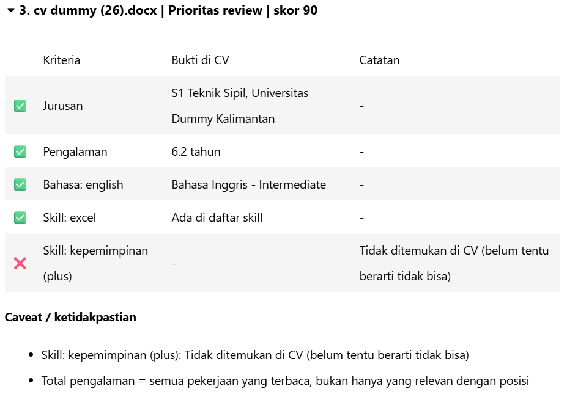

# CV Extractor 

---

## Masalah Bisnis
HR mendapat banyak ratusan lamaran dari pencari kerja dan itu akan memakan waktu jika dikerjakan secara manual, jadi ia meminta untuk dibuatkan sebuah sistem untuk mengotomastisasi proses screening CVnya. 

---

## Objektif
Ia juga menambahkan beberapa kriteria diantaranya:
1. Mendapat rekomendasi sesuai dengan request.
2. Tambahkan ketidakpastian, jadi decision akhir tetap di HR.
3. Kasih sample input/output.
4. Jangan membeli tool/API berbayar.
5. Jangan menggunakan data pribadi atau confidential data nyata.

---

## How I solve This Problem
Bisa disimpulkan HR ingin system screener CV otomatis, tapi ingin tetap menjaga data pribadi para pencari kerja. Banyak opsi untuk menyelesaikannya, tapi berhubung opsinya terbatas di repo/notebook/docs maka saya pilih notebook yang di push ke repo. Setp penyelesaian:
1. Karena HR ingin data terjaga dan penggunaan api berbayar dilarang (gratis bisa tapi terbatas itu akan menghambat nantinya) maka kita gunakan LLM lokal.
2. LLM lokal yang saya gunakan adalah llama 3.1 8B parameter, tugas dia sebagai otak untuk extract cv. Gratis dan unlimited.
3. Buat system prompt untuk mengambil data yang kita inginkan seperti jurusan, pengalaman kerja, skill, serta rules seperti penambahan ketidakpastian.
4. Tentukan bobot penilaian(saya pilih 50% untuk relevansi jurusan, 30% untuk skill wajib, 10% skill plus, 5% pengalaman, dan 5% bahasa asing).
5. Pengelompokan berdasarkan score apakah layak diproses selanjutnya atau tidak.
6. Terakhir, untuk HR yang biasanya non-it akan pusing jika melihat code, maka saya percantik UInya untuk input kriterianya.
Selesai output akan diterima dalam bentuk excel, sebagai catatan semua file cv yang akan digunakan dapat di simpan di folder yang sama dalam format docx atau pdf.

---

## Cara pakai
1. Pastikan Ollama jalan dan nama model sama dengan `MODEL` di notebook.
2. `pip install -r requirements.txt`.
3. Buka notebook, **Run All**. Pastikan path folder CV sudah terisi, bisa diubah di cell konfigurasi.
4. Isi form kriteria, lalu klik **Analisis CV**.
5. Hasil: tabel ranking, detail per kandidat (bukti + caveat), dan file `output/hasil_<waktu>.xlsx`.

---

## Arsitektur yang Digunakan

1. llama 3.1 8B: sebagai extractor (hanya untuk extract cv karena cukup berat sisanya rule based code).
2. requests: kirim teks CV ke server Ollama lokal (/api/chat) dan terima hasil ekstraksi LLM.
3. pydantic: definisi skema data (Candidate, Education, dll.), memaksa output LLM berbentuk JSON sesuai skema, memvalidasi hasilnya, dan menyimpannya ke cache.
4. pypdf: baca teks dari CV berformat PDF (tanpa OCR, jadi PDF scan tidak terbaca).
5. python_docx: baca teks dari CV berformat DOCX, termasuk tabel dan text box.
6. pandas: susun hasil jadi tabel, beri warna per rekomendasi, dan ekspor ke Excel.
7. ipywidgets: bangun UI interaktif (form kriteria, slider, tombol "Analisis CV", progress bar, accordion detail).
8. ipython: display dan HTML untuk menampilkan widget, tabel, dan detail kandidat di notebook.

---

## Membaca Hasil
- **Prioritas review**: semua syarat wajib terpenuhi, tidak ada masalah kualitas berat.
- **Perlu review manual**: ada yang sebagian/tidak jelas, atau ekstraksi meragukan.
- **Kemungkinan kurang sesuai**: ada syarat wajib yang tidak terpenuhi.
- Status per kriteria: ✅ terpenuhi, ⚠️ sebagian, ❓ tidak jelas, ❌ tidak terpenuhi. Caveat menjelaskan sumber ketidakpastiannya.

---

## Evaluasi Hasil
Hasil cukup sesuai ekspektasi saya dan menjawab permasalahan yang dialami HR. CV terfilter dengan baik sesuai dengan kriteria yang diinput.

---

## Batasan
- Kapasitas llm dengan 8b paramater terbatas, jadi terkadang mengalami kekeliruan walaupun sudah di prompt spesifik.
- LLM dengan parameter 8b cukup memakan waktu dalam prosses komputasinya.
- Kadang ada jurusan yang tidak terdeteksi, jadi harus eksplisit dituliskan.

---

## Future Improvement
- Coba dengan API freetier, agar berjalan di pc lebih ringan.
- Compare dengan llm local lain seperti qwen dan bandingkan hasilnya.

---

## Tech Stack
- ipython==9.10.0
- ipywidgets==8.1.8
- pandas==3.1.1
- pydantic==2.14.3
- pypdf==7.0.1
- python_docx==1.2.0
- Requests==2.34.2
